<div align="center">



<br />

[](https://github.com/sergiocalazans/portfolio-v2)
[](https://www.linkedin.com/in/sergio-calazans/)
[](https://github.com/sergiocalazans?tab=repositories)



</div>

### `// 01` THE ORIGIN STORY

> **The Force is strong with this code.**

I'm **Sérgio Calazans**, a **Computer Science undergraduate at PUCPR**, a software developer, and an enthusiast of **data engineering, automation, artificial intelligence, and cybersecurity**. My coding journey began in 2021, growing from small experiments into web applications, data pipelines, automations, and IoT projects.

I enjoy connecting **software engineering and data science** to turn complex challenges into practical, well-documented solutions.

```text
┌────────────────────── GALACTIC PERSONNEL FILE ──────────────────────┐
│ DESIGNATION      Computer Science Undergraduate · PUCPR            │
│ SPECIALTIES      Software Development · Data · Automation · AI     │
│ OTHER SYSTEMS    Cybersecurity · IoT · Distributed Computing       │
│ ACTIVE PROTOCOL  Learning · Experimenting · Building              │
└─────────────────────────────────────────────────────────────────────┘
```

### `// 02` CHOOSE YOUR PATH

<div align="center">

| 🔵 THE LIGHT SIDE | 🟡 THE EXPLORER PATH | 🔴 THE DARK SIDE |
|:---:|:---:|:---:|
| **Software Engineering** | **Data & AI** | **Cybersecurity** |
| React · Python · SQL | Pandas · PySpark · Power BI | Research · Networks · Systems |
| Build reliable systems | Discover patterns in data | Understand and defend systems |

</div>

### `// 03` THE TECH ARSENAL

<div align="center">

**Core languages**


**Engineering & interfaces**


**The data galaxy**


</div>

### `// 04` FEATURED MISSIONS

| Mission | Briefing | Stack |
|:---|:---|:---|
| [**Sistema-X**](https://github.com/sergiocalazans/Sistema-X) | Clinical screening web application with assessment management and reporting. | `Flask` `MySQL` `Docker` |
| [**Big Data · MapReduce**](https://github.com/sergiocalazans/big-data-mapreduce-pjbl1) | Distributed data processing and analytics using Hadoop. | `Java` `Hadoop` |
| [**Big Data · PySpark**](https://github.com/sergiocalazans/big-data-pyspark) | Data queries and transformations using Apache Spark. | `Python` `PySpark` `SparkSQL` |
| [**ESP32 · IoT & MQTT**](https://github.com/sergiocalazans/esp32-iot-mqtt) | Sensor monitoring, rule-based alerts, and MQTT communication. | `ESP32` `MicroPython` `MQTT` |
| [**Curriculum Advisor**](https://github.com/sergiocalazans/curriculum-advisor) | Rule-based logic and inference for academic course planning. | `Prolog` |

<div align="center">

[**VIEW ALL MISSIONS »**](https://github.com/sergiocalazans?tab=repositories)

</div>

### `// 05` GALACTIC ACTIVITY

<div align="center">


</div>

> Language statistics reflect public repository data, not necessarily proficiency. Live cards are hosted by a third-party service and may occasionally be unavailable.

---

<div align="center">

**THE JOURNEY CONTINUES...**

<sub>Built with curiosity, code and a little bit of the Force · © Sérgio Calazans</sub>

</div>
